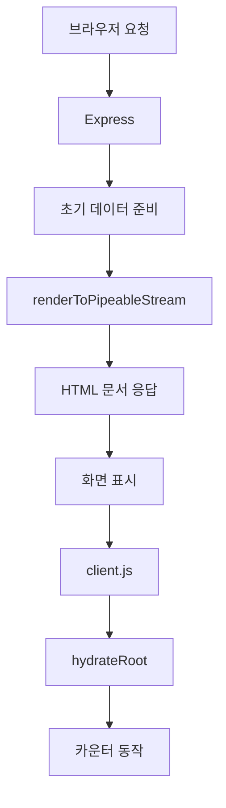

# 한밭대학교 Express + React SSR 스타터

한밭대학교(Hanbat National University, HBNU) 웹 서버 과제용 뼈대입니다.
Express가 React 컴포넌트를 서버에서 HTML로 만들고, 브라우저는 그 HTML을 받아 버튼 같은 이벤트를 연결합니다.

자바스크립트를 끄고 열어도 본문과 서버 데이터는 보입니다.
카운터의 증가와 감소는 hydration이 끝난 뒤에만 동작합니다.

## SSR과 hydration

1. 브라우저가 `/` 또는 `/about`을 요청합니다.
2. `src/server/data.js`가 이번 요청의 초기 데이터를 만듭니다.
3. `src/server/render.jsx`가 `react-dom/server`의 `renderToPipeableStream`으로 `<App>`을 HTML로 그립니다.
4. Express가 완전한 HTML 문서를 보냅니다. `#root` 안에 페이지가 있고, 그 아래 스크립트에 `window.__INITIAL_DATA__`가 있습니다.
5. 브라우저는 HTML을 먼저 그립니다. 이때는 버튼에 아직 이벤트가 없습니다.
6. `/assets/client.js`가 실행되면 `hydrateRoot`가 서버 HTML을 갈아끼우지 않고 이벤트를 붙입니다.
7. 카운터 버튼을 누르면 숫자가 바뀝니다.



초기 데이터는 `JSON.stringify` 결과를 스크립트에 그대로 붙이지 않습니다.
`<`를 `\u003c`로 바꿔서, 값 안에 `</script>`가 있어도 태그가 끊기지 않습니다.
코드는 `src/shared/serialize.js`에 있습니다.

서버가 만든 시각 문자열을 그대로 출력합니다. 브라우저에서 `Date`를 다시 포맷하면 서버 HTML과 달라져 hydration이 실패할 수 있습니다.

## 폴더

```text
src/server     Express, 요청 데이터, HTML 응답
src/client     hydrateRoot 진입점과 스타일
src/shared     서버와 브라우저가 같이 쓰는 화면
public         번들하지 않는 정적 파일
scripts        esbuild 개발 서버와 빌드
dist           빌드 결과. git에 넣지 않습니다.
```

Express는 `dist/client`를 `/assets`로, `dist/public`을 사이트 루트의 정적 파일로 제공합니다.

## 실행

Node.js 20 이상이 필요합니다.

```bash
npm install
npm run dev
```

개발 서버 주소는 <http://localhost:3000> 입니다.
`src/server`를 저장하면 Node 프로세스가 다시 시작됩니다.
`src/client`와 `src/shared`를 저장하면 번들이 다시 만들어지니 브라우저를 새로고침하면 됩니다.

빌드 후 프로덕션 모드로 실행합니다.

```bash
npm run build
npm start
```

포트는 `PORT`입니다. 프로젝트 루트에 `.env`를 두고 `PORT=3000`처럼 적거나, 셸에서 `PORT=4000 npm start`로 넘깁니다. `.env.example`을 복사해 쓸 수 있습니다. 셸에 이미 값이 있으면 그 값이 우선합니다. `npm start`는 프로젝트 루트에서 실행합니다.

## 라우트

| 경로 | 내용 |
| --- | --- |
| `/` | 서버 데이터와 카운터 |
| `/about` | SSR과 hydration 설명 |
| 그 외 | 404. 상태 코드도 404입니다. |

링크는 일반 `<a>`입니다. 페이지를 옮길 때마다 서버가 HTML을 다시 만듭니다.

## 기술 스택

이 저장소를 만들 때 맞춘 안정 버전입니다.

| | 버전 | 하는 일 |
| --- | --- | --- |
| Node.js | 20+ | 서버 실행. 소스는 ESM |
| Express | 5.3 | HTTP와 정적 파일 |
| React, React DOM | 19.3 | 화면, `renderToPipeableStream`, `hydrateRoot` |
| esbuild | 0.28 | 클라이언트 번들과 서버 번들 |

번들러는 esbuild입니다. 결과가 파일로 남아서 흐름이 짧습니다. 브라우저는 `dist/client/client.js`를 받고, Node는 `dist/server/index.js`를 실행합니다. React와 Express는 서버 번들에 넣지 않고 Node가 `node_modules`에서 불러옵니다. Vite SSR도 널리 쓰이지만, 개발 중에는 Vite가 모듈을 대신 변환해서 처음 읽을 때 요청이 HTML이 되는 지점이 더 깊습니다. 이 뼈대는 그 지점을 `src/server/render.jsx`에 둡니다.

## 고치는 위치

- 서버 데이터: `src/server/data.js`
- 페이지: `src/shared/pages`
- 라우트: `src/shared/routes.js`의 `routes` 배열
- 모양: `src/client/styles.css`
